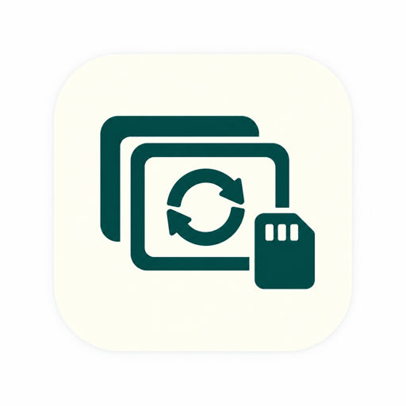

# CardMe

**A free Mac app to help rescue photos from memory cards.**

I know how it feels to lose photos you can’t take again. A faulty card adapter damaged my own memory card, and trying to recover those photographs became the beginning of CardMe.

I made this tool to help others save their priceless memories. It offers a clear next step, keeps recovery on your Mac, and shows honestly what it could save. Sometimes that is a full-size photo; sometimes only a smaller preview survives. No tool can promise to recover everything, but you shouldn’t have to face the process alone.

[Website](https://getpickology.com/cardme) · [繁體中文](https://getpickology.com/cardme/zh-hant) · [Download for Mac](https://getpickology.com/cardme) · [Buy me a coffee ☕️](https://ko-fi.com/alittleseal)

## Getting started

Requires **macOS 14 or later and an Apple silicon Mac**. You don’t need an account, Python, or separately installed recovery tools.

1. Download the signed, Apple-notarized DMG from the [website](https://getpickology.com/cardme). Open it and drag **CardMe** into Applications.
2. Stop using the affected card for new photos. Connect it with a working reader, open CardMe, and choose your card.
3. Let CardMe check the photos. Select **Rescue to…**, then choose a folder on your Mac or another fixed drive to save recovered copies.
4. Review the results. Use **↑ / ↓** to move through the list and **Space** for Quick Look. Full-size photos, previews, tiny thumbnails, and unsuccessful recovery are distinguished.
5. If photos are still missing, try **Deep Rescue**. It first saves a whole-card safety copy, then searches that copy. You need more free space than the card’s full capacity, plus room for rescued photos. Larger cards take longer.

The main photo list can reveal available files in Finder. Saved photos remain yours, whether or not you choose to support the project.

## Your card and your privacy

CardMe’s source-card operations are **read only**. It does not format, repair, delete, or write recovered files back to your card. Results are saved separately, and existing results are not overwritten.

For whole-card access, macOS opens a read-only file descriptor through `authopen`; the bundled imaging tool receives that descriptor. CardMe checks device identity and rejects unsafe output destinations. Neither CardMe nor the recovery tool runs as root. Photos are processed locally and are not uploaded. Usage statistics are enabled by default and can be turned off in **CardMe → Settings → Privacy**. We receive app opens, app version, scan totals, photos flagged for review, scan completion/failure/cancellation, rescue mode and result counts (full-size, preview, thumbnail, review and unrecovered), and coffee-link clicks. There is no installation identifier, photo metadata, name, path or card identifier. App opens measure launches, not unique people; result counts may include the same photo rescued again. Reports are scheduled for deletion after 90 days; cleanup backlogs may take longer. Uploads are best-effort, with no offline backlog, and never block recovery. Turning the setting off cancels outstanding uploads; requests already transmitted may still arrive and earlier records remain. Our Azure hosting service necessarily receives network addresses and may retain request metadata. Coffee clicks do not indicate a donation.

This describes CardMe’s own operations, not a hardware write blocker: macOS, another application, or a failing reader can still affect a connected card. If the card disconnects repeatedly or has physical damage, stop and consider a professional recovery service. Read-only access cannot prevent failing hardware from deteriorating during reads.

## What it can recover

- Damaged JPEG files that can still be decoded, or their embedded previews and thumbnails.
- Intact, contiguous JPEG data after deletion or a quick format, using Deep Rescue.
- Some fragmented camera JPEGs when a surviving MPF index and preview identify a unique two-part reconstruction on an exFAT safety copy. Rebuilt photos are marked for checking.

Normal rescue may save a decoded full-size photo as PNG. That preserves the decoded image, but is not necessarily the original JPEG file. Deep Rescue copies verified JPEG streams without generating replacement pixels. A successfully decoded photo can still contain visible damage; please inspect your results.

**RAW recovery, other fragmented-photo reconstruction, and overwritten data are currently not supported.** A quick scan checks thumbnails, metadata, and image headers; it does not certify every pixel. Full pixel checks are available in Details. Recovery is never guaranteed.

## License and support

CardMe is free to use. This repository is currently private; its original code and website are licensed under the [MIT License](LICENSE). Bundled tools and libraries keep their own licenses, including GNU ddrescue under GPL-2.0-or-later. The app includes notices, complete ddrescue corresponding source, its patch, and build instructions. See [third-party notices](THIRD_PARTY_NOTICES.md).

If CardMe helped you, you’re welcome to [buy me a coffee](https://ko-fi.com/alittleseal). Thank you for your support. There is no payment required to rescue or save photos.

Bug reports and small improvements are welcome. Please **don’t upload personal photographs, card images, or private recovery logs** to public issues. Start with your Mac model, macOS version, CardMe version, and a description of what happened.

## Development

CardMe is currently a **0.x public beta**. Releases use semantic version tags and an increasing build number; the [changelog](CHANGELOG.md) records actual changes. GitHub Releases in this private repository are available to collaborators only. The public download is hosted separately on Azure. The first versioned repository release is `v0.3.16` (build 29), following the earlier development builds.

See [development and safety details](docs/DEVELOPMENT.md), [contributing](CONTRIBUTING.md), and [release instructions](docs/RELEASING.md). The website source is in [`website/dist`](website/dist). The internal Xcode project and executable retain the name `CardRescue` for compatibility.
