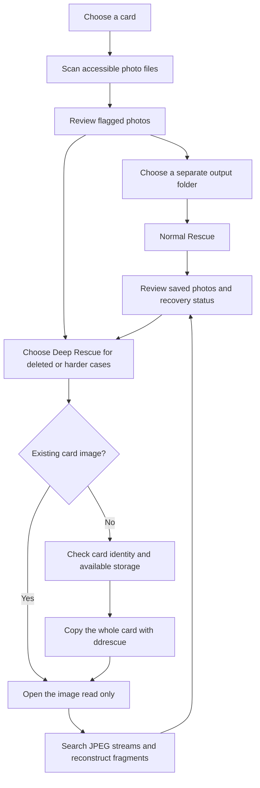
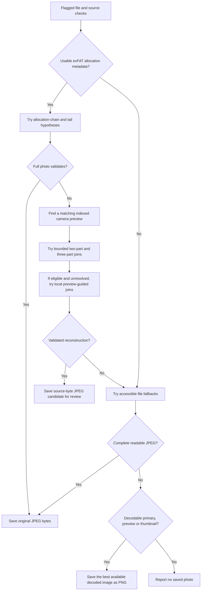
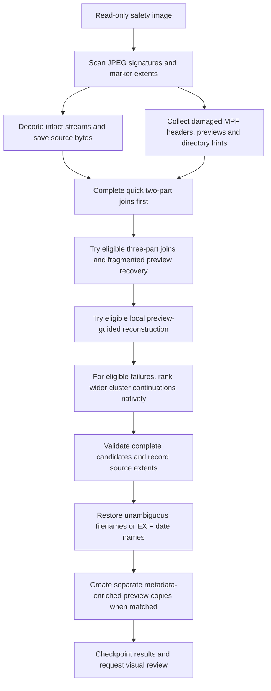

# How CardMe recovers photos

This describes the current source on `main`. A signed download may use an older engine; see the [changelog](../CHANGELOG.md) for version-specific changes.

CardMe first tries the accessible photo files. For deleted files, a quick format, or harder damage, Deep Rescue searches a whole-card safety copy. Every recovered file is saved separately. The engine uses surviving source bytes and JPEG decoding; it does not generate missing image content.

## Normal vs. Deep Rescue

**The main difference is where the search starts and how much of the source it searches.** Normal starts with damaged files still visible in the filesystem and uses their surviving allocation and camera metadata to look for missing fragments. Deep scans a whole-card safety copy for JPEG data, including photos that no longer have a visible file entry, and can try wider reconstruction searches.

| | Normal Rescue | Deep Rescue |
| --- | --- | --- |
| Best starting point | Photos are still listed but cannot open, or look damaged. | Photos were deleted, the card was quickly formatted, files are missing, or Normal could not recover the full photo. |
| Input | Accessible files and, on supported exFAT cards, direct read-only access to their allocation and fragment regions. | A new whole-card safety copy or an existing card image opened read only. |
| Needs a surviving file list? | Yes. Recovery targets the scan's flagged files. | No. JPEG carving can discover streams without directory entries. |
| Search scope | File decoding, allocation-chain hypotheses, and bounded fragment searches using surviving MPF/preview clues. It does not scan every byte to discover all deleted photos. | A scan across the image for JPEG streams, followed by eligible local and wider cluster-based fragment searches. |
| Whole-card copy required? | No. | Yes for the current app's Deep workflow; an existing image skips the copying step. The copy is a workflow/safety choice, not a requirement of JPEG decoding itself. |
| Extra storage | Recovered outputs and working files. | The card's full capacity for a new image, plus recovered outputs and working files. |
| Time | Usually faster when only a few visible files are damaged. Bounded fragment searches can still take time. | Includes copying the card, scanning its full image and possibly longer reconstruction. An existing image avoids only the copy time. |
| Original JPEG recovery | Can preserve or rebuild full-size JPEGs when enough source data and clues survive. | Can preserve or rebuild full-size JPEGs, including some that Normal cannot locate. |
| Lower-resolution fallback | Can save a decoded primary PNG, camera preview or thumbnail. | Can save surviving previews/thumbnails and separate metadata-enriched preview copies. |
| Source writes | None by CardMe. | None by CardMe, including to the safety image. |

**Start with Normal when the damaged files are still visible. Use Deep for missing/deleted files, a quick format, or unresolved Normal results.** Deep searches more data; it does not guarantee a better result for every photo and cannot undo overwritten data. Both modes can recover original JPGs, and both can leave uncertain candidates that need visual review. Neither mode is simply a choice between JPG and PNG.

## Start to finish

| Step | What it does | What it establishes |
| --- | --- | --- |
| Select source | Identify the card and its capacity. A saved image can be selected for Deep Rescue. | Which source the run is allowed to read. |
| Scan files | Check embedded thumbnail, EXIF, then image headers and MPF length bounds. Stop inspecting a file on failure; continue with the next file. Missing optional metadata is not itself corruption. | A list of damaged or suspect files. A quick scan does **not** validate every pixel. |
| Optional full scan | Decode image pixels and embedded frames, and compare the primary image with its thumbnail when present. | More evidence of damage; successful decoding still does not prove authenticity. |
| Choose output | Validate separate storage and prevent overwriting existing results. | A safe destination for recovered copies. |
| Rescue | Run the appropriate pipeline below, publishing results as they become available. | A full-size photo, a review candidate, a lower-resolution fallback, or an explanation of failure. |
| Review | Show the recovery classifications. Use arrow keys and Space for Quick Look. | The user checks whether the recovered photograph is usable. |

## Normal Rescue: selected files, direct card reads

Normal Rescue works from the scan's flagged files. On supported exFAT cards it can also read hidden fragments directly through an authorized read-only descriptor; a whole-card image is not required for this path. If allocation geometry is unsupported, it falls back to the accessible files.

The join stages stop when a result is accepted. An ambiguity, unsafe source, failed validation or exhausted budget can end a search; the engine does not automatically try every later method after every refusal.

| Stage | What it does | Why it helps |
| --- | --- | --- |
| Source and allocation checks | Parse supported exFAT geometry, file entries and allocation chains; verify that the file and allocation metadata have not changed. | Recover the starting cluster and test current allocation information without a private recovery map. |
| Allocation hypotheses | Try the recorded chain, repaired chain variants, contiguous placement and bounded tail hypotheses. Decode the primary image, compare its thumbnail and load embedded frames. | A damaged directory or allocation chain may still leave all JPEG bytes intact. |
| Preview anchor search | Read the surviving MPF index, then probe near the indexed preview location and allocation endpoints. Require a matching preview; refuse multiple matches. | MPF gives logical stream sizes and preview placement. A surviving preview can constrain the end of the primary photo. |
| Two/three-part reconstruction | Test cluster-boundary prefix, middle and tail combinations using marker-failure information, JPEG structure, full decoding and thumbnail/preview agreement. | Reconnect a small number of separated source ranges. |
| Local preview-guided reconstruction | Advance JPEG coding checkpoints and rank nearby continuation blocks against the camera preview's reduced image. Retry an observed earlier prefix when eligible. | Find additional joins without enumerating every possible byte arrangement. |
| Preserve metadata and preview | Keep EXIF already present in the recovered JPEG. Append the indexed preview and intervening source bytes only when physical and logical placement agree and the frames decode. | Preserve original direction and embedded content when those bytes survive. Missing preview placement keeps the result under review. |
| File fallback | Fully decode accessible frames. Copy complete readable JPEGs unchanged; otherwise save the best decoded primary, preview or thumbnail as PNG. | Return useful surviving image content when a complete original JPEG cannot be retained. |

The additional Normal reconstruction phase is bounded to **90 seconds, 256 MiB of requested reads and 4,096 preview probes per unresolved photo**. Sector alignment can increase physical bytes read. Earlier allocation attempts have their own bounds. Normal does not run the whole-image native ranking search; its injected reader keeps raw-card reads aligned.

## Deep Rescue: search a safety copy

Deep Rescue can work without a surviving file list. A new copy requires enough destination capacity for the card's full size, plus recovered files. ddrescue records read errors and progress in a map file; copying bytes cannot repair data that has already been overwritten.

Intact photos can be saved before reconstruction completes. The two-pass schedule establishes quick results before harder searches use verified recovered ranges as exclusion hints. The arrows describe stage order; accepted candidates and explicit refusals skip later searches.

| Stage | What it does | Why it helps |
| --- | --- | --- |
| Whole-card copy | Use bundled GNU ddrescue with a read-only source descriptor, identity checks and safe output paths. Alternatively open an existing image read only. | Separate repeated searches from the physical card and retain unreadable-sector evidence. |
| JPEG carving | Stream through the image for JPEG starts. Walk marker lengths and entropy byte stuffing to locate primary endings, then decode and save valid streams. | Find photos after deletion or a quick format even when their directory entries are gone. Embedded JPEG endings are not treated as primary endings. |
| Collect clues | Retain usable damaged headers, MPF entries, preview candidates, marker-failure offsets, JPEG end positions and surviving exFAT directory entries. | Build hypotheses from this image rather than old offsets or reference photos. |
| Quick joins | Try two-part reconstruction across candidates first. | Save easy results early and establish recovered byte ranges before harder work. |
| Additional local joins | Attempt eligible three-part joins and preview-guided continuation. When necessary, try reconstructing the indexed preview itself from two ranges. | Recover photos whose primary stream or anchor preview is fragmented. |
| Wider native ranking | For selected local-search failures, use the bundled C++ JPEG checkpoint ranker to search allocation-cluster starts. Prioritize the observed photo region, then consider the remainder. Try luminance screening, bounded alternative paths and color ranking. | Reduce expensive complete decodes by rejecting unlikely continuations early. This is bounded heuristic search, not exhaustive reconstruction. |
| Candidate validation | Require complete JPEG structure, supported dimensions, full pixel decoding and the applicable thumbnail/preview agreement checks. Record source extents and SHA-256. | Reject malformed or inconsistent joins and make saved candidates traceable. Decodability and source-byte provenance are not proof of correct assembly. |
| Filename restoration | Use an unambiguous surviving directory name; otherwise use an available EXIF capture timestamp or a recovery name. Handle collisions without overwriting. | Give recovered files useful names without inventing an original `IMG_` number. |
| Preview metadata assembly | Pair a saved preview with a matching camera header. Write a separate JPEG copy with selected descriptive EXIF and a thumbnail, preserving its compressed image stream. Do not transplant GPS, serial numbers, MakerNote or unsafe offsets. | Restore useful direction and date metadata to a preview. It does not turn a preview into a full-size original. |
| Checkpoint and publish | Save progress and completed outputs; check source identity and saved-result hashes on resume. | Preserve completed work after cancellation and reject changed sources or output conflicts. |

Wider ranking uses bounded paths and joins, with a **900-second budget per ranking phase**. Saved-image probes can use up to four CPU workers; photo joining and final validation remain ordered. No Metal acceleration or external local model is required. Normal reconstruction does not invoke this whole-image native scan.

## Reading the result

| Result | Meaning |
| --- | --- |
| Full-size JPEG saved | A readable source JPEG or validated allocation-based result was saved without re-encoding. |
| Full-size photo rebuilt | Source ranges were joined into a decodable full-size JPEG. Check it visually; source-byte identity does not establish that the joins are correct. |
| Full-size candidate / manual review | A heuristic join, disagreement or other uncertainty requires inspection. Some review entries may have no saved file; inspect the reported reason. |
| Full-size PNG copy | Full-size pixels could be decoded, but the engine could not preserve a complete supported JPEG. PNG avoids another lossy JPEG encode; it does not restore missing original bytes or all original metadata. |
| Camera preview / thumbnail | Only lower-resolution content was recovered. Metadata enrichment does not change that resolution. |
| No saved photo | No usable image was produced within the supported methods and limits. This does not prove every byte is absent. |

## Safety, dependencies and evidence

CardMe never writes recovered files to the source card or alters the source image. It checks source identity, rejects unsafe destinations, publishes without replacing existing files and supports cancellation. This is software read-only access, not a hardware write blocker; macOS and other programs are outside that boundary.

The runtime bundles **GNU ddrescue**, **CPython**, **Pillow** and CardMe's own JPEG reconstruction/checkpoint code. **PhotoRec was used in early experiments and comparisons; the current app does not invoke or bundle it.** See [third-party notices](../THIRD_PARTY_NOTICES.md).

The production search does not receive historical card images, known-answer byte locations, or private recovery recipes. Reference hashes in benchmarks are evaluated after recovery. See [development documentation](DEVELOPMENT.md) for implementation details and focused checks, including [licensed public-content regression fixtures](../tests/fixtures/public-jpeg/README.md).

Public-content tests cover exact reconstruction of synthetic fragments, not an independent real damaged-card dataset. Missing or overwritten bytes, unsupported coding modes and fragment layouts outside the search bounds can remain unresolved.
